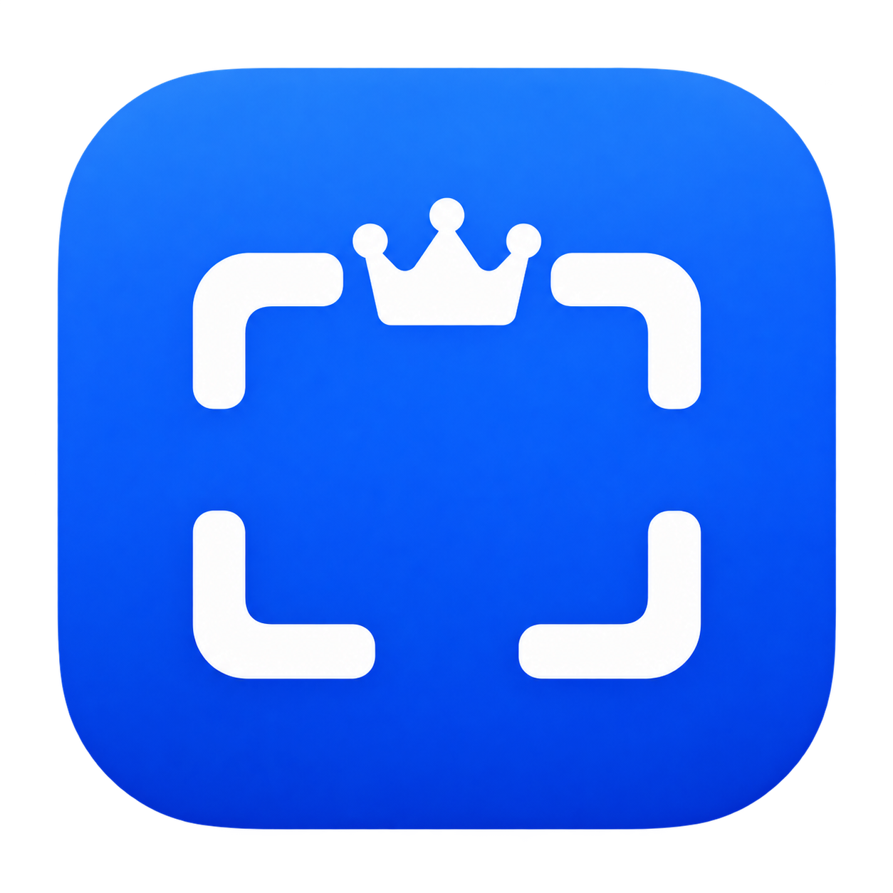
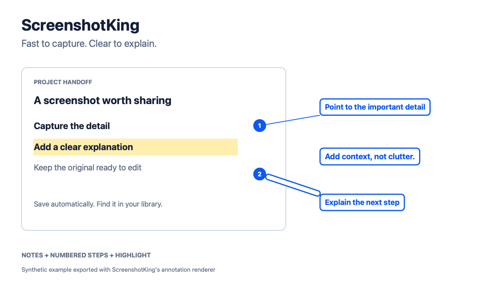
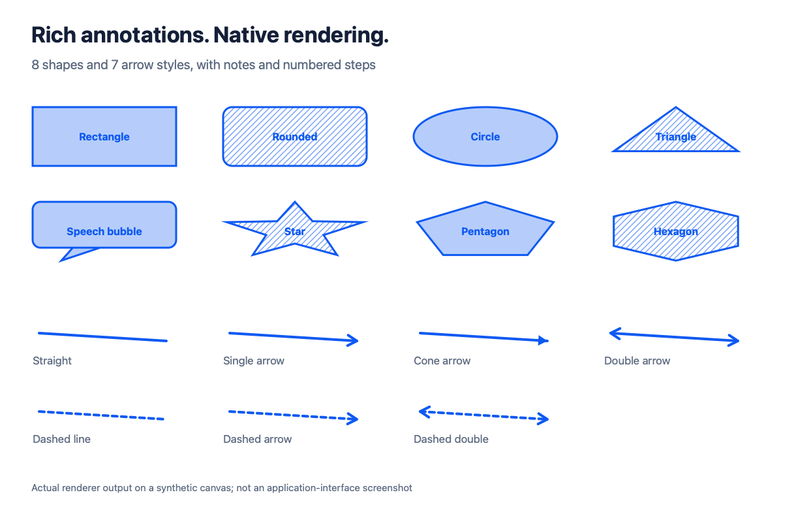

# ScreenshotKing

<p align="center">
  
</p>

<p align="center">
  <strong>Quick screenshots. Rich annotations. Just 4.7 MiB.</strong><br>
  Capture with a shortcut. Automatically saved, copied, and organized by time. Add notes and numbered steps when you need to explain more.
</p>

<p align="center">
  <a href="README.md">English</a> · <a href="README.zh-CN.md">Simplified Chinese</a> · <a href="https://github.com/StarrHuang/screenshotking/releases/latest">Latest release</a> · <a href="docs/releases/0.3.0-build12.md">Build 12 notes</a>
</p>

**macOS 15+ · Apple Silicon · 2.3 MiB download · 4.7 MiB installed app**

> **Download ScreenshotKing 0.3.0 build12:** [Apple Silicon ZIP](https://github.com/StarrHuang/screenshotking/releases/download/v0.3.0-build12/ScreenshotKing-0.3.0-build12-macOS-arm64.zip) · [SHA-256 checksums](https://github.com/StarrHuang/screenshotking/releases/download/v0.3.0-build12/SHA256SUMS.txt)
>
> This ad hoc signed development build is not notarized by Apple. The app interface is currently primarily in Simplified Chinese.



*English annotation output exported with ScreenshotKing's own renderer on a synthetic example.*

## Capture quickly. Find it later.

Press a shortcut to capture a region, window, or screen. By default, ScreenshotKing saves the image and copies it to the clipboard, with a timestamped filename. The editor stays closed until you choose to open a capture. Images also appear in a local library ordered by time, so you can reopen the right one without interrupting your flow.

Silent saves go to your configured folder, or `~/Pictures/ScreenshotKing` by default. Name collisions are resolved without overwriting an existing file. The local library keeps its own chronological capture list. These are straightforward time-based organization choices, not automatic labels or semantic sorting.

## Lightweight app. Full annotation toolkit.

Reopen a capture from the library or choose **Edit Recent Screenshot** from the menu bar or File menu. Add notes and numbered steps with explanations and leader lines, then mark up the image with arrows, shapes, highlights, text, pixelation or blur, crop, magnification, stickers, and watermarks.

Style, move, or copy annotation objects; undo and redo changes; export PNG, JPEG, or HEIC. Open a library capture in the editor to save an editable `.skedit` project with annotation data and source and working images. The silent export remains a regular image.

<details>
<summary>More annotation styles</summary>


</details>

## Also included

- **Long screenshots:** capture vertical or horizontal pages by automatic scrolling or manual section capture. The workflow has a 30-frame limit; dynamic pages and sticky headers need broader compatibility verification.
- **Screen recording:** record with optional system audio. System audio, microphone, and camera are off by default. Microphone and camera recording have not been live-verified for this release.
- **Local clipboard history:** optionally monitor text, rich text, images, and multiple files while preserving item formats and order. Search, favorite, tag, categorize, copy in original or plain-text form, and back up or restore. Monitoring is off by default.
- **Local recognition and translation:** Apple Vision recognizes text and QR/barcodes. Apple Translation can translate recognized text or create a translated image overlay. Offline language assets may need to be downloaded first.

## Install and use

1. Download and expand the Apple Silicon ZIP above.
2. Move `ScreenshotKing.app` to Applications and open it.
3. Allow Screen & System Audio Recording to capture. Accessibility permission is needed for automatic scrolling and active paste.
4. Use a shortcut to capture, then reopen the image from the library when you want to annotate.

Default shortcuts:

| Action | Shortcut |
|---|---|
| Region / window capture | `⌃⌥⌘1` |
| Clipboard history | `⌃⌥⌘2` |
| Repeat previous selection | `⌃⌥⌘3` |
| Long screenshot | `⌃⌥⌘4` |
| Start / stop recording | `⌃⌥⌘R` |

Shortcuts can be changed in Settings. Press Escape to cancel a capture.

## Implementation at a glance

| User outcome | Implementation | Source |
|---|---|---|
| Capture and record with native macOS frameworks | AppKit capture flow and ScreenCaptureKit recording | [`Capture.swift`](Sources/Capture.swift) · [`Recorder.swift`](Sources/Recorder.swift) |
| Save and find captures by time | Timestamped names, collision-safe exports, and a chronological local PNG library | [`Export.swift`](Sources/Export.swift) · [`Library.swift`](Sources/Library.swift) |
| Reopen and edit notes and numbered steps | `.skedit` JSON stores annotation objects alongside source and working PNGs | [`ImageEditor.swift`](Sources/ImageEditor.swift) · [`AnnotationStyle.swift`](Sources/AnnotationStyle.swift) |
| Keep structured clipboard history on this Mac | Local pasteboard entries, search, and history management | [`Clipboard.swift`](Sources/Clipboard.swift) |
| Recognize text and codes, then translate | Vision recognition and Apple Translation integration | [`ImageIntelligence.swift`](Sources/ImageIntelligence.swift) |
| Export without replacing an existing file | Image encoding and collision-safe output naming | [`Export.swift`](Sources/Export.swift) |

The app is built with Swift, AppKit, and SwiftUI. It has no Electron shell, account, bundled third-party runtime, or iCloud sync. The size figures above describe the ZIP and installed app; they are not speed benchmarks.

## Build and verification

Requirements: macOS 15 or later, Xcode command-line tools, and an Apple Silicon Mac.

```sh
./scripts/build.sh
open build/ScreenshotKing.app
./scripts/test.sh
```

The test script covers geometry, image export and processing, document recovery, local clipboard behavior, OCR, and QR recognition. These tests use a private pasteboard; native QA helpers can touch the system clipboard. The release's native verification includes silent save and clipboard image output, reopening a capture for editing, and selected annotation and clipboard behavior. See the [verification record](docs/verification.md) and [feature coverage matrix](docs/parity-matrix.md) for evidence and limits.

For detailed usage, see the [capture and annotation guide (Chinese)](docs/screenshot-workflow.md). For repository publication and README localization, see the [GitHub publishing notes (Chinese)](docs/github-publishing.md).

This repository does not currently include a software license. Found a bug or have a feature request? [Open an issue](https://github.com/StarrHuang/screenshotking/issues) and include your macOS version, Mac model, and steps to reproduce.
