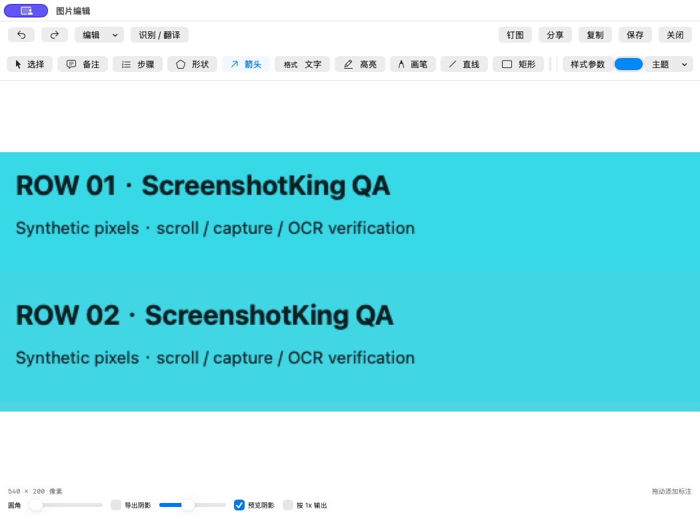
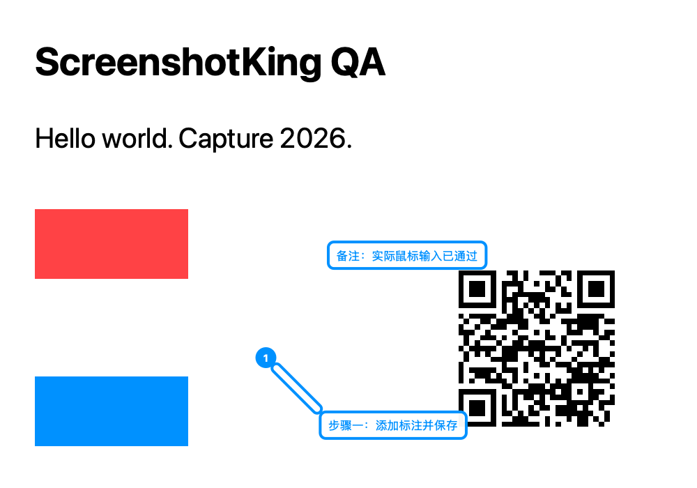
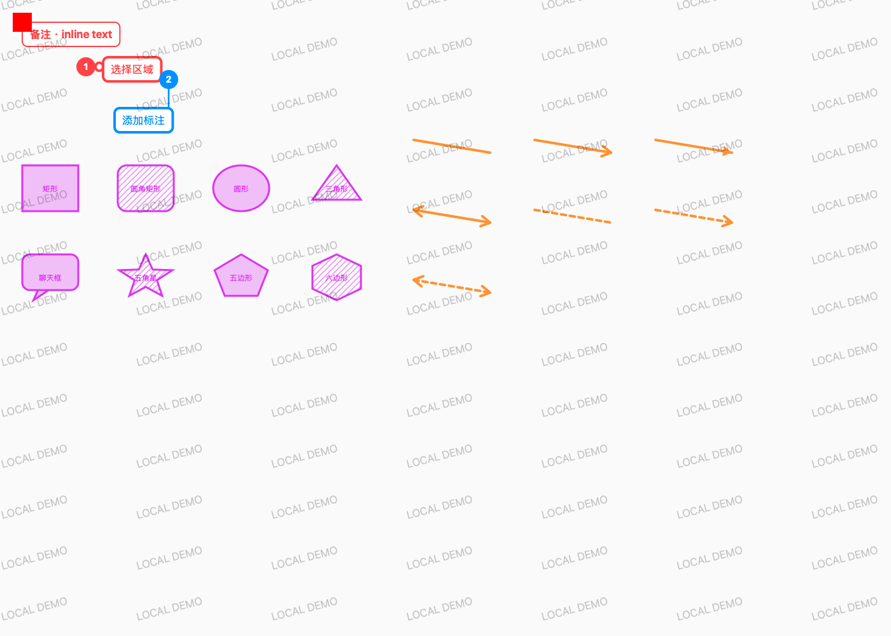

# ScreenshotKing

<p align="center">
  
</p>

<p align="center">
  <strong>截图快，自动归档；标注全，体积仅约 4.7 MiB。</strong><br>
  快捷键截图，自动保存、复制并按时间归档。需要讲清重点时，再用备注、编号步骤和完整标注工具继续编辑。
</p>

<p align="center">
  <a href="README.md">English</a> · <a href="README.zh-CN.md">简体中文</a> · <a href="https://github.com/StarrHuang/screenshotking/releases/latest">最新版本</a> · <a href="docs/releases/0.3.0-build12.md">build12 发布说明</a>
</p>

**macOS 15+ · Apple Silicon · 下载包 2.3 MiB · 安装后约 4.7 MiB**

> **下载 ScreenshotKing 0.3.0 build12：**[Apple Silicon ZIP](https://github.com/StarrHuang/screenshotking/releases/download/v0.3.0-build12/ScreenshotKing-0.3.0-build12-macOS-arm64.zip) · [SHA-256 校验值](https://github.com/StarrHuang/screenshotking/releases/download/v0.3.0-build12/SHA256SUMS.txt)
>
> 此版本使用 ad hoc 签名，未经 Apple 公证。应用界面目前以简体中文为主。



## 截图快，之后好找

按快捷键截取区域、窗口或屏幕。默认情况下，ScreenshotKing 会自动保存图片并复制到剪贴板，文件名带有时间信息。编辑器不会自动弹出；图片也会加入按时间排序的本地截图库，需要时可重新打开，不打断当前工作。

静默保存使用已配置的文件夹；未设置时默认保存到 `~/Pictures/ScreenshotKing`。遇到同名文件时会另选文件名，不覆盖已有文件。截图库有独立的按时间排序列表。这是基于时间的整理，不会自动生成语义标签或进行智能分类。

## 体积轻，标注不精简

从截图库重新打开截图，或从菜单栏、文件菜单选择“编辑最近截图”。添加备注、带说明和引线的编号步骤，再用箭头、形状、高亮、文字、像素化或模糊、裁剪、放大镜、贴纸和水印标记重点。



*build9 在合成测试图上完成备注与步骤后的真实应用导出。*

编辑器支持调整对象样式、移动和复制对象、撤销和重做，并导出 PNG、JPEG 或 HEIC。从截图库打开图片进行编辑时，会保存包含标注数据、源图和工作图的可编辑 `.skedit` 项目；静默导出的文件仍是普通图片。

<details>
<summary>查看更多标注样式</summary>



此图是渲染器测试样例，并非应用工具栏截图。
</details>

## 其他功能

- **长截图：**自动滚动或手动拼接纵向、横向页面，最多 30 帧；动态页面和固定导航栏仍需更多兼容性验证。
- **屏幕录制：**可选择系统音频。系统音频、麦克风和摄像头默认关闭；本次发布尚未实录验证麦克风和摄像头路径。
- **本地剪贴板历史：**可选监听文本、富文本、图片和多个文件，并保留各项格式与顺序。支持搜索、收藏、标签、分类、按原格式或纯文本复制，以及备份和恢复。监听默认关闭。
- **本地识别与翻译：**Apple Vision 可识别文字、二维码和条形码；Apple Translation 可翻译识别出的文字，或生成翻译后的图片覆盖层。首次使用可能需要下载离线语言资源。

## 安装与使用

1. 下载并解压上方的 Apple Silicon ZIP。
2. 将 `ScreenshotKing.app` 移入“应用程序”后打开。
3. 截图时按提示允许“屏幕与系统音频录制”；自动滚动和主动粘贴需要辅助功能权限。
4. 使用快捷键截图；需要标注时，从截图库重新打开。

默认快捷键：

| 操作 | 快捷键 |
|---|---|
| 区域 / 窗口截图 | `⌃⌥⌘1` |
| 剪贴板历史 | `⌃⌥⌘2` |
| 重复上次选区 | `⌃⌥⌘3` |
| 长截图 | `⌃⌥⌘4` |
| 开始 / 停止录屏 | `⌃⌥⌘R` |

可在设置中修改快捷键；截图时按 Esc 取消。

## 实现一览

| 用户目标 | 实现方式 | 源码 |
|---|---|---|
| 使用 macOS 原生框架截图或录屏 | AppKit 截图流程与 ScreenCaptureKit 录屏 | [`Capture.swift`](Sources/Capture.swift) · [`Recorder.swift`](Sources/Recorder.swift) |
| 按时间保存并查找截图 | 时间戳文件名、避免覆盖的导出、本地按时间排序的 PNG 截图库 | [`Export.swift`](Sources/Export.swift) · [`Library.swift`](Sources/Library.swift) |
| 重新打开并编辑备注和编号步骤 | `.skedit` JSON 保存标注对象以及源图、工作 PNG | [`ImageEditor.swift`](Sources/ImageEditor.swift) · [`AnnotationStyle.swift`](Sources/AnnotationStyle.swift) |
| 在本机保留结构化剪贴板历史 | 本地剪贴板条目、搜索与历史管理 | [`Clipboard.swift`](Sources/Clipboard.swift) |
| 识别文字和码，并进行翻译 | Vision 识别与 Apple Translation 集成 | [`ImageIntelligence.swift`](Sources/ImageIntelligence.swift) |
| 导出时不覆盖已有文件 | 图像编码与冲突安全的输出命名 | [`Export.swift`](Sources/Export.swift) |

应用使用 Swift、AppKit 和 SwiftUI 构建，不使用 Electron，没有账号、捆绑的第三方运行时或 iCloud 同步。包体积数据不代表速度基准。

## 构建与验证

需要 macOS 15 或更新版本、Xcode 命令行工具和 Apple Silicon Mac。

```sh
./scripts/build.sh
open build/ScreenshotKing.app
./scripts/test.sh
```

测试脚本覆盖几何计算、图像导出与处理、文档恢复、本地剪贴板行为、OCR 和二维码识别。测试使用独立的私有剪贴板；原生 QA 辅助程序可能操作系统剪贴板。此版本已实机验证静默保存和剪贴板图片输出、重新打开截图编辑，以及部分标注和剪贴板行为。证据与限制见[验证记录](docs/verification.md)和[功能覆盖表](docs/parity-matrix.md)。

详细操作见[截图与标注指南](docs/screenshot-workflow.md)；仓库发布和 README 本地化方法见[GitHub 发布说明](docs/github-publishing.md)。

此仓库目前没有软件许可证。遇到问题或有功能建议？请[提交 Issue](https://github.com/StarrHuang/screenshotking/issues)，并在适用时附上 macOS 版本、Mac 型号和复现步骤。
